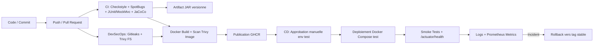

# LibraFlow — Chaîne DevOps Complète (L3 DSI)

Application web de gestion d'une bibliothèque universitaire industrialisée avec une chaîne DevOps complète (CI/CD, qualité logicielle, conteneurisation, DevSecOps, déploiement automatisé, supervision et rollback).

---

## 1. Chaîne DevOps mise en œuvre



---

## 2. Fonctionnalités de l'application support

- **Authentification & rôles (`Spring Security` + `BCrypt`)** : rôles `ADMIN` (bibliothécaire) et `MEMBER` (étudiant), inscription libre `/register`.
- **Gestion du catalogue (`/books`, `/api/books`)** : consultation, recherche par titre/auteur, ajout et suppression (admin), suivi du stock (`availableCopies / totalCopies`).
- **Gestion des emprunts (`/loans`, `/api/loans`)** : emprunt d'un livre disponible (décrémente le stock), retour d'un livre (restaure le stock), blocage si stock épuisé.
- **Observabilité (`Spring Boot Actuator` + `Micrometer Prometheus`)** : `/actuator/health`, `/actuator/info`, `/actuator/metrics`, `/actuator/prometheus`, et journaux applicatifs dans `logs/libraflow.log`.

---

## 3. Organisation du binôme (Section 8 de l'énoncé)

| Membre | Responsabilité principale | Tâches associées |
| :--- | :--- | :--- |
| **Étudiant A** | Intégration & Qualité | Git, stratégie de branches, `ci.yml`, Maven, Checkstyle, SpotBugs, tests JUnit/MockMvc, JaCoCo, artefacts |
| **Étudiant B** | Livraison & Exploitation | `Dockerfile`, `docker-compose*.yml`, GHCR, secrets/configs, `cd.yml`, `rollback.yml`, Gitleaks/Trivy, Prometheus & supervision |

> Les deux membres participent aux revues de Pull Requests et maîtrisent l'ensemble de la chaîne pour la soutenance.

---

## 4. Démarrage rapide en local (Développement)

1. Copier `.env.example` vers `.env` et renseigner des mots de passe locaux :
   ```bash
   cp .env.example .env
   ```
2. Lancer la stack de développement (PostgreSQL + LibraFlow) :
   ```bash
   docker compose up -d --build
   ```
3. Accéder à l'application :
   - Web UI : `http://localhost:8080/login`
   - Santé : `http://localhost:8080/actuator/health`
   - API Catalogue : `http://localhost:8080/api/books`

### Exécuter les vérifications qualité & tests localement
```bash
mvn checkstyle:check
mvn verify -Dspring.profiles.active=ci
```
Les rapports sont générés dans `target/surefire-reports/`, `target/site/jacoco/index.html` et `target/spotbugsXml.xml`.

---

## 5. Documentation et livrables

- Stratégie Git & contribution : [CONTRIBUTING.md](CONTRIBUTING.md)
- Matrice des environnements, variables & secrets : [docs/CONFIG_MATRIX.md](docs/CONFIG_MATRIX.md)
- Supervision, diagnostic & rollback : [docs/SUPERVISION_ET_INCIDENTS.md](docs/SUPERVISION_ET_INCIDENTS.md)
- Fiche d'incident : [docs/FICHE_INCIDENT.md](docs/FICHE_INCIDENT.md)
- Guide de soutenance & fiche de remise : [docs/FICHE_REMISE_ET_SOUTENANCE.md](docs/FICHE_REMISE_ET_SOUTENANCE.md)
